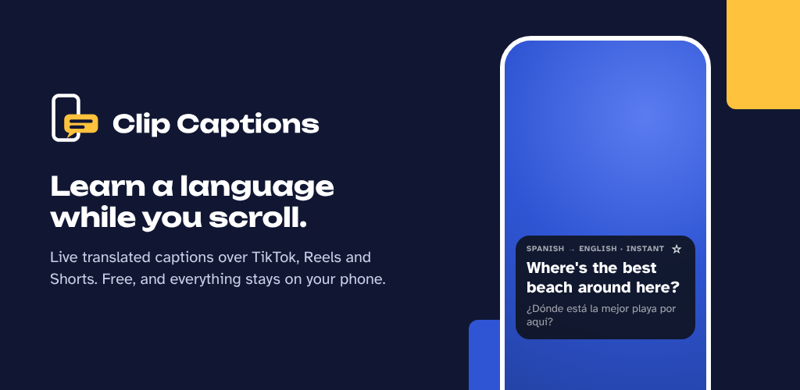
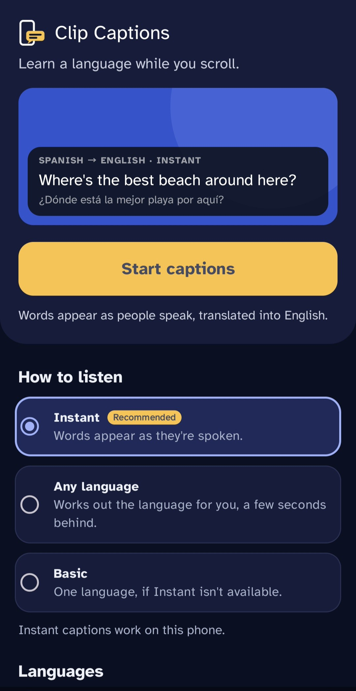
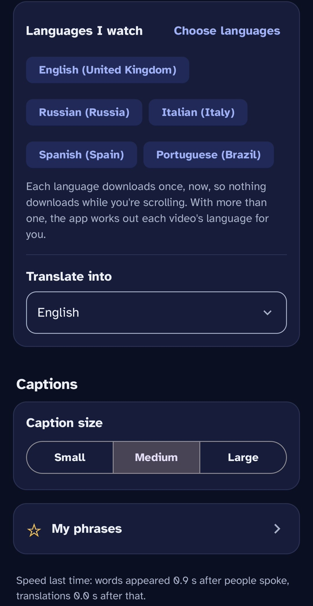

# Clip Captions

**Live translated captions over TikTok, Reels and Shorts. Learn a language while you scroll.**

Clip Captions shows what people say in videos as text, translated into your language, in a small box over the video. It reads the sound your phone is playing, so it works with AirPods and headphones in. Speech recognition and translation run on the phone: nothing is recorded or uploaded, and it's free, with no adverts or accounts.

  
  

## Download

- **[Latest version](https://github.com/controlclips/ClipCaptions/releases/latest):** tap the `.apk` file under **Assets**, then open it to install. Updates install over the previous version and keep your settings and languages.
- Coming soon to [Orion Store](https://github.com/RookieEnough/Orion-Store), which installs updates for you.

Needs Android 10 or newer. **Instant** needs Android 13 or newer with Google's on-device speech recognition (most phones with Google apps).

## What it does

- **Instant:** words appear as they're spoken, translated a moment later. Tick the languages you watch and it works out each video's language for you.
- **Any language:** works out the language of every video by itself, from about 99 languages.
- **Basic:** word-by-word captions for 17 languages, for phones that can't run the other two.
- **Good offline translation:** Mozilla's translator (the one in Firefox), on the phone, for about 58 languages.
- **Swipe and it clears:** the next video's captions start fresh.
- **My phrases:** tap ☆ to save a line with its translation, then copy or share your phrases to learn them.
- **Saves battery:** listening pauses when nothing is playing and stops after 20 quiet minutes.

Every download happens once, before captions start, never while you're scrolling.

## Privacy

Clip Captions only uses the sound of the app you choose to share, turns it into words and translates them on the phone, then throws the sound away. It has no accounts, adverts, analytics or tracking. The internet is only used to download the speech and translation files for your languages. Details: [PRIVACY.md](PRIVACY.md).

### What it asks to allow

- **Display over other apps:** to show the caption box over TikTok and other apps.
- **Microphone** (Android's name for sound capture): to hear the sound of the app you share. The microphone itself isn't used.
- **Screen sharing:** Android's way of letting an app capture another app's sound. Only the sound is used, but Android shows its sharing indicator while captions are on.
- **Notifications:** for the "captions are on" notification with its Stop button.

## Using it

The app's main screen calls the three options **Instant** (Google's on-phone speech recognition, recommended), **Any language** (Whisper) and **Basic** (Vosk).

1. Open Clip Captions. Choose **Instant**, **Any language** or **Basic**. For Instant or Any language, tap **Choose languages** and tick every language you watch (they download once, there and then). Choose the language you want to read. Leave **Accuracy** on Automatic unless captions lag (choose Fast) or you want to try a bigger model (Better or Best).
2. Tap **Start captions**. The first time, allow **Display over other apps** and the sound permission (Android lists it as Microphone; the app doesn't use the microphone), then wait for the download.
3. Android asks what to share. Choose **A single app** and pick the app you'll watch (for example TikTok). Your notifications stay visible, because Android hides notification content only while the whole screen is shared. Only the sound is used and nothing is saved, but Android shows its screen-sharing indicator while captions are on.
4. TikTok opens. Play a video. Drag the caption box up or down; tap ✕ (or **Stop** in the notification) to turn captions off.

## Also in the app

- **Listening for the right languages (Instant):** Instant only understands the languages ticked under **Languages I watch**; a video in any other language comes out as nonsense. The main screen warns when only the caption language is ticked, the language list opens straight after the setup guide, and every video's language is spotted: if it's clearly one you haven't ticked, the caption box offers "Tap to add Spanish", which adds and downloads it.

- **First-time guide:** three short steps the first time the app opens (what it does, the two things Android asks you to allow and why, and what to choose when sharing). **Setup guide** on the main screen opens it again.
- **My phrases:** tap ☆ on the caption box to save the words on screen with their translation. **My phrases** on the main screen lists them; tap one to copy or delete it, or share them all (to notes or a flashcard app).
- **Battery saving:** after a minute with nothing playing, listening pauses and starts again the moment sound comes back. After 20 minutes with nothing playing, captions turn themselves off.
- **Report a problem:** fills in a report (a space to describe what happened, then the phone model, Android version, app settings, speed readout, recent problems and the last crash, if any) and opens it as a new issue on this GitHub page, ready to post. **Share instead** sends it any other way. Nothing is sent unless you send it.

## Good to know

- **Caption size** (Small, Medium, Large) is in the app, and the caption box remembers where you last dragged it.
- Clear speech works best. Loud music under the voice, heavy slang and very fast talking reduce accuracy.
- A language you didn't tick under **Languages I watch** shows untranslated (or, in Whisper mode with English captions, translated by Whisper) until its translation has downloaded in the background. The caption box's label says "translation downloading" meanwhile.
- Basic uses a different, word-by-word engine (Vosk): it's faster but less accurate than the other two.
- If the box says no sound is coming through while a video is playing, that app is blocking sound capture on your phone.
- Google Play Protect may warn that the app is from an unknown developer, because it isn't from the Play Store. Choose **Install anyway**.

## How it works

The main screen calls the three ways to caption **Instant**, **Any language** and **Basic**. All three are free and run on the phone.

- **Instant: Google, word by word** (recommended). Uses the Google speech recognition built into the phone (Android 13 or newer, on phones that include Google's on-device recogniser). It's free, writes the words as they're spoken, and the sound never leaves the phone. Under **Languages I watch**, tick every language you watch: each one's speech pack and translation pack are downloaded once, straight away, so captions never wait for a download while you scroll. With more than one language ticked, the app spots each video's language itself from its first couple of seconds of speech, using Whisper's smallest model on a short window (a fraction of a second, one-off 31 MB download), and tells Google. Only the speech is used (a small speech detector leaves out music and background noise), and it decides after about 1.2 seconds when it's sure, or waits for a little more speech when it isn't. If the video isn't in the language Google was listening for, Google starts that video again in the right language. Google's own detection, used only if the spotter can't run, can take several seconds. Swiping to the next video doesn't restart the recogniser (which would cost up to a second): the box clears and the old video's leftover words are dropped, so the new video's words appear as soon as they're spoken.
  - **Speed:** words show the moment they're heard and their translation replaces them when it's ready. When someone talks without pausing, the sentence is shown as short lines that are each translated once, so translating doesn't slow down as the sentence grows. When a sentence ends, the translation already on screen is kept rather than redone, and sound heard while Google restarts between sentences is kept and passed on, so first words aren't lost.
  - **Speed readout:** after captions stop, the main screen shows how long words took to appear after people spoke, and how long the translation took after that, as measured on your phone.
  - Safety check: if a phone's recogniser can't take app sound, Android has it use the microphone instead. The app checks within a couple of seconds that the recogniser really is reading the video's sound; if not, it stops straight away, shows nothing it heard, and switches to Whisper. "Check this phone again" retries later.
- **Any language: Whisper, detected automatically.** Whisper (OpenAI's free, open-source speech model, via whisper.cpp) works out the language of each video by itself, from about 99 languages. Captions appear in short bursts a few seconds after the speech.
  - **Languages I watch:** tick the languages you watch and their translations download once, straight away, before captions start. A language you didn't tick still works: if you read English, Whisper translates it into English itself straight away while the better translation downloads quietly in the background; otherwise its words show as heard until then.
  - **Accuracy setting:** Fast (31 MB), Better (57 MB) or Best (181 MB). On Automatic, the app times each model once on the phone and uses the most accurate one that keeps captions quick. If captions start falling behind, it steps down to a smaller one by itself.
  - **Speed:** the model loads while Android's sharing question is on screen. Whisper only processes about 15 seconds of its 30-second window (our speech pieces are at most 6 seconds), which roughly halves the work. Speech is sent after about 1.6 seconds instead of waiting longer.
  - **Faster engine on newer phones:** 64-bit phones with ARMv8.2 dot-product instructions (most phones from about 2018 onwards) use a build of Whisper that's roughly twice as fast. Other phones use the standard build.
  - **Quick language spotting:** each video's language is spotted with the small model on a short window, so the main model only has to write the words down. Speech is sent in short pieces (at most 3.5 seconds, and 2 seconds for a video's first words), so captions come a few words at a time instead of a long wait and then a wall of text, and each piece only uses as much of Whisper's window as it needs. If you've ticked languages under **Languages I watch**, the spotter chooses between those (and the one you read), unless another language is clearly being spoken.
  - **One language per video:** as soon as Whisper is confident of the language (or two pieces of speech in a row agree), it's told that language for the rest of the video instead of detecting it each time. Detecting costs about twice as much as writing the words down.
  - **Translation:** Whisper writes the words in their own language and the translator turns them into yours, with the original shown underneath. For languages with no translation on the phone, Whisper translates into English itself.
  - A small speech detector skips music and noise, speech is cut into pieces at natural pauses so words aren't split, and phrases Whisper tends to invent over music ("Thanks for watching") are filtered out.
- **Basic: choose the language yourself.** Vosk writes the words as they're spoken, word by word, for 17 languages (30–90 MB download per language). This is also the fallback on the few phones that can't run automatic detection.

**Translation** uses Mozilla's offline translator, the one built into Firefox, running on the phone (about 25 MB to download per language pair). Pairs that don't involve English go through English, using two models. Google ML Kit (about 30 MB per language) covers the few languages Mozilla doesn't, and steps in if a Mozilla download fails. Newer phones (with the i8mm instructions) get a faster build of the translator; the app checks the phone's processor and picks. Every download happens once, before captions start, never while a video is playing. Captions never stop to wait for one, and the languages you watch are loaded into memory before the first video so the first caption is translated at full speed. After the first downloads, captions work offline.

**Swiping to the next video clears the captions** and the new video's words show as soon as they're recognised (the old video's half-finished sentence is dropped, without hiding a new sentence; Whisper stops working on the old video straight away) (TikTok, Instagram Reels, YouTube Shorts and similar). The app notices when a different video starts playing, or a video starts straight after you touch the screen. Pausing a video doesn't clear them, so you can stop to read.

## Problems and ideas

Use **Report a problem** in the app, or [open an issue](https://github.com/controlclips/ClipCaptions/issues). Please describe what you were watching and what happened.

## Building it yourself

The app is in the `ClipCaptions` folder. GitHub builds it on every push (`.github/workflows/main.yml`) and puts the APK on the Releases page.

- **On GitHub:** fork this repository and open the **Actions** tab. Builds take about 20 minutes. A fork makes *test builds*, signed with the test key in `ClipCaptions/keystore/debug.keystore`, which won't install over the official app.
- **In Android Studio:** open the `ClipCaptions` folder and build. Without the next step, the app builds fine but translates with ML Kit only.
- **Mozilla's translator** (`ClipCaptions/translator`) is Rust. With Rust, the Android NDK and [cargo-ndk](https://github.com/bbqsrc/cargo-ndk) installed, build it into the app as the workflow does (see the "Build the offline translator" step).
- **Translation models** are copied from Mozilla to this repository's `models` release once a month by `.github/workflows/models.yml`.
- **Official builds** are signed with `ClipCaptions/keystore/release.p12`, which is locked with a password kept in the repository's `RELEASE_KEY_PASSWORD` secret.

## Licence

Clip Captions is free software under the [GNU General Public License v3](LICENSE), with an extra permission to combine it with Google ML Kit. It includes and downloads parts made by others under their own licences: see [NOTICE.md](NOTICE.md).

Clip Captions isn't made by, or connected with, TikTok, Instagram, YouTube, Mozilla or Google.
